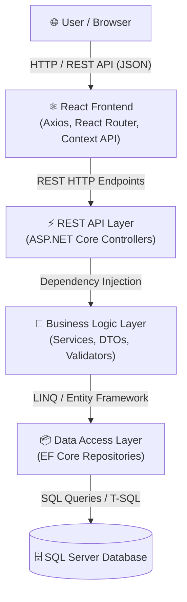
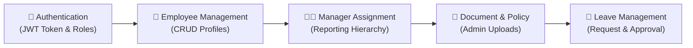
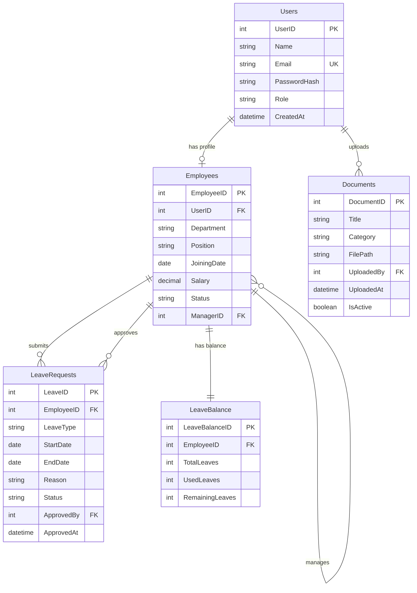
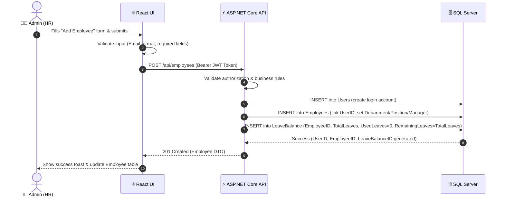
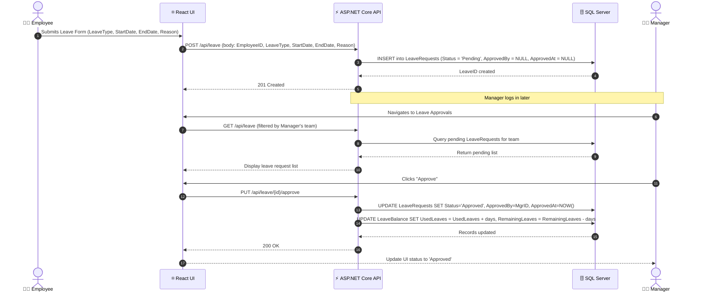
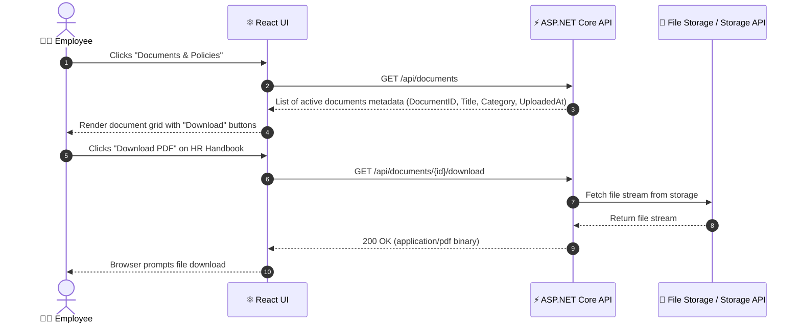

# Human Resource Management System (HRMS)
### Project Design Document
**Version:** 1.0 &nbsp;|&nbsp; **Date:** October 2026 &nbsp;|&nbsp; **Status:** Draft

---

## 1. Project Overview

| Field | Details |
|---|---|
| **Project Name** | Human Resource Management System (HRMS) |
| **Type** | Full-Stack Web Application |
| **Scope** | Internal enterprise tool for HR operations |
| **Version** | 1.0 (Sample / Academic Project) |

### Assumptions

- Each employee has exactly one login account.
- Each employee may have one direct reporting manager; top-level employees may not have a manager.
- Managers can approve or reject leave only for their directly assigned employees.
- Only Admin/HR users can upload and manage company documents.
- Employees cannot modify their own salary, department, or reporting manager.
- Documents are stored in local file storage for this sample implementation.

### What It Does
HRMS is a web-based platform that allows organizations to digitally manage their entire employee lifecycle — from onboarding and policy/document access to leave tracking — all from a single, role-based dashboard.

### Target Users

| Role | Responsibilities |
|---|---|
| **Admin / HR** | Manage employees, upload company documents & policies, manage leave approvals |
| **Manager** | View team members, approve/reject leave requests |
| **Employee** | View own profile, view company documents & policies, apply for leave |

---

## 2. Requirements

### 2.1 Functional Requirements

- **Authentication & Authorization:** Role-based login (Admin, Manager, Employee)
- **Employee Management:** Add, view, update, and deactivate employee records
- **Manager Assignment:** Assign a manager to each employee; managers see only their team
- **Document & Policy Management:** Admins upload company documents and policies (company policies, employee handbook, HR guidelines, templates, compliance documents); employees can view and download them
- **Leave Management:** Employees can apply for leave, managers can approve/reject requests, and the system maintains the employee's leave balance.

### 2.2 Non-Functional Requirements

| Category | Requirement |
|---|---|
| **Security** | JWT-based authentication, role-based access control, hashed passwords |
| **Performance** | API responses under 500ms for standard queries; support up to 500 concurrent users |
| **Scalability** | Modular layered architecture to allow addition of new modules (e.g., appraisal, training) |
| **Usability** | Clean, responsive UI usable on desktop and tablet; minimal learning curve |
| **Reliability** | Data validation on both client and server; graceful error handling throughout |

---

## 3. Technology Stack

| Layer | Technology | Reason |
|---|---|---|
| **Frontend** | React.js ,axios| Component-based UI, fast rendering, large ecosystem |
| **Backend** | ASP.NET Core (C#) | Strongly typed, robust REST API support, enterprise-grade |
| **Database** | SQL Server (MSSQL) | Relational data with complex joins; ACID compliance |
| **Authentication** | JWT (JSON Web Tokens) | Stateless, scalable token-based auth |
| **ORM** | Daper | Code-first migrations, LINQ-based queries |
| **File Storage** | Local File System / Azure Blob (optional) | Admin document uploads (PDF, images) |
| **API Style** | RESTful HTTP API | Simple, stateless, standard |
| **Dev Tools** | Visual Studio 2022, VS Code, Postman | Development and API testing |

---

## 4. System Architecture ⭐

### Layer Descriptions

| Layer | Responsibility |
|---|---|
| **React Frontend** | Renders UI, manages local state, calls APIs via Axios, handles routing |
| **REST API (Controllers)** | Receives HTTP requests, validates input, returns JSON responses |
| **Business Logic (Services)** | Core logic — employee creation rules, leave balance checks, document access control |
| **Data Access (Repositories)** | EF Core queries to read/write database; abstracts raw SQL |
| **SQL Server** | Persists all application data; enforces constraints and referential integrity |

---

## 5. Modules

### Module Descriptions

| Module | Description |
|---|---|
| **Authentication** | Handles login/logout. Issues JWT token containing user role. All protected routes require a valid token. |
| **Employee Management** | HR can add new employees, edit their details (department, salary, status), and deactivate records without deletion. |
| **Manager Assignment** | Each employee may have an assigned manager. Managers can view/manage only their direct reports. Admins can assign or reassign managers. |
| **Document & Policy Management** | Admins upload company-wide documents and policies (e.g., company policies, employee handbook, HR guidelines, templates, compliance documents). Employees can view and download relevant documents. No employee-side uploads. |
| **Leave Management** | Employees submit leave requests with leave type, date range, and reason. Managers approve/reject. Leave balance (UsedLeaves, RemainingLeaves) is updated automatically on approval. |

---

## 6. Database Design ⭐

### Tables & Key Fields

**`Users`**
| Column | Type | Notes |
|---|---|---|
| UserID | INT (PK) | Auto-increment |
| Name | NVARCHAR(100) | Full name |
| Email | NVARCHAR(150) | Unique, used for login |
| PasswordHash | NVARCHAR(255) | BCrypt hashed |
| Role | NVARCHAR(20) | Admin / Manager / Employee |
| CreatedAt | DATETIME | Account creation timestamp |

**`Employees`**
| Column | Type | Notes |
|---|---|---|
| EmployeeID | INT (PK) | Auto-increment |
| UserID | INT (FK → Users, UNIQUE) | Linked login account; enforces one-to-one |
| Department | NVARCHAR(100) | e.g., Engineering, HR |
| Position | NVARCHAR(100) | Job title |
| JoiningDate | DATE | |
| Salary | DECIMAL(10,2) | Basic salary |
| Status | NVARCHAR(20) | Active / Inactive |
| ManagerID | INT (FK → Employees) | Self-referencing; NULL for top-level employees |

**`Documents`**
| Column | Type | Notes |
|---|---|---|
| DocumentID | INT (PK) | |
| Title | NVARCHAR(200) | Document/policy name |
| Category | NVARCHAR(50) | Policy, Handbook, Template, etc. |
| FilePath | NVARCHAR(500) | Server-side file path |
| UploadedBy | INT (FK → Users) | Admin who uploaded |
| UploadedAt | DATETIME | |
| IsActive | BIT | Soft-delete / hide from employees |

**`LeaveRequests`**
| Column | Type | Notes |
|---|---|---|
| LeaveID | INT (PK) | Auto-increment |
| EmployeeID | INT (FK → Employees) | Employee requesting leave |
| LeaveType | NVARCHAR(30) | Casual / Sick / Earned |
| StartDate | DATE | Leave start date |
| EndDate | DATE | Leave end date |
| Reason | NVARCHAR(500) | Reason for leave |
| Status | NVARCHAR(20) | Pending / Approved / Rejected |
| ApprovedBy | INT (FK → Employees) | Manager who acted |
| ApprovedAt | DATETIME NULL | Approval/rejection timestamp |

**`LeaveBalance`**
| Column | Type | Notes |
|---|---|---|
| LeaveBalanceID | INT (PK) | Auto-increment |
| EmployeeID | INT (FK → Employees, UNIQUE) | One balance record per employee |
| TotalLeaves | INT | Annual allocated leaves |
| UsedLeaves | INT | Leaves already used |
| RemainingLeaves | INT | Available leaves |

### Relationships
- `Users` → `Employees` : One-to-One (UserID is UNIQUE in Employees; each login maps to exactly one employee profile)
- `Employees` → `Employees` : Self-referencing One-to-Many (ManagerID references EmployeeID; one manager oversees many employees)
- `Users` → `Documents` : One-to-Many (an Admin user can upload many documents)
- `Employees` → `LeaveRequests` : One-to-Many (an employee can submit multiple leave requests, via EmployeeID)
- `Employees` → `LeaveBalance` : One-to-One (each employee has exactly one leave balance record)
- `Employees` → `LeaveRequests` via ApprovedBy : One-to-Many (a manager can approve/reject multiple leave requests)

### ER Diagram (Mermaid Schema & Visual Diagram)

> **Note:** `FilePath` in the Documents table is internal to the backend and is not exposed via the API.

---

## 7. API Design

### Authentication

| Method | Endpoint | Access | Purpose |
|---|---|---|---|
| POST | `/api/auth/login` | Public | Login and receive JWT token |
| POST | `/api/auth/logout` | Auth | Invalidate token (client-side) |
| GET | `/api/auth/me` | Auth | Get logged-in user info |

### Employee Management

| Method | Endpoint | Access | Purpose |
|---|---|---|---|
| GET | `/api/employees` | Admin, Manager | Get all / filtered employees |
| GET | `/api/employees/{id}` | Auth | Get single employee detail |
| POST | `/api/employees` | Admin | Add new employee |
| PUT | `/api/employees/{id}` | Admin | Update employee details |
| PATCH | `/api/employees/{id}/status` | Admin | Activate or deactivate an employee |

### Document & Policy Management

| Method | Endpoint | Access | Purpose |
|---|---|---|---|
| GET | `/api/documents` | Auth | Returns metadata list: DocumentID, Title, Category, UploadedAt |
| GET | `/api/documents/{id}` | Auth | Returns single document metadata (no FilePath) |
| GET | `/api/documents/{id}/download` | Auth | Streams the actual file; FilePath is resolved server-side only |
| POST | `/api/documents` | Admin | Upload a new document or policy |
| PUT | `/api/documents/{id}` | Admin | Edit document title/category |
| PATCH | `/api/documents/{id}/deactivate` | Admin | Deactivate (hide) a document; sets IsActive = false |

### Leave Management

| Method | Endpoint | Access | Purpose |
|---|---|---|---|
| GET | `/api/leave` | Auth | Get leave requests (filtered by role) |
| GET | `/api/leave/balance` | Auth | Get logged-in employee's leave balance |
| POST | `/api/leave` | Employee | Submit leave request (body: EmployeeID, LeaveType, StartDate, EndDate, Reason) |
| PUT | `/api/leave/{id}/approve` | Manager | Approve leave; updates Status, ApprovedBy, ApprovedAt, UsedLeaves, RemainingLeaves |
| PUT | `/api/leave/{id}/reject` | Manager | Reject leave; updates Status, ApprovedBy, ApprovedAt |

---

## 8. UI Design

The wireframes below illustrate the key pages of the application. The layout uses a consistent sidebar navigation, top header with user info, and content area.

### Page Descriptions

| Page | Description |
|---|---|
| **Login** | Centered card with email/password fields and JWT-based authentication |
| **Employee List** | Searchable, filterable table with pagination; Add Employee button (Admin only) |
| **Document & Policies** | Admin view: upload/manage docs. Employee view: browse and download company policies, HR guidelines, handbook, templates, and compliance documents |
| **Leave Requests** | Tabbed view — Pending, Approved, Rejected; approve/reject buttons for managers. Employees see a **Leave Balance** panel showing total allocated leaves, used leaves, and remaining leaves. |

---

## 9. Data / Application Flow

### Flow 1: Admin Adds a New Employee

### Flow 2: Employee Applies for Leave & Manager Approves

### Flow 3: Employee Views & Downloads Company Policy

---

## 10. Security

| Concern | Implementation |
|---|---|
| **Authentication** | JWT tokens with expiry (e.g., 24 hours). Tokens sent in `Authorization: Bearer` header. |
| **Authorization** | Role-based access control via `[Authorize(Roles = "Admin")]` attributes in ASP.NET Core. Managers can only see their own team. |
| **Password Security** | Passwords are never stored as plain text. BCrypt hashing applied before saving to database. |
| **Input Validation** | Client-side validation in React + server-side validation using Data Annotations and FluentValidation. |
| **CORS Policy** | Backend configured to allow requests only from the known frontend origin. |
| **File Upload Safety** | Admin uploads only. Allowed MIME types (PDF, JPEG, PNG). File size capped. Files stored outside the web root. |
| **HTTPS** | All production traffic served over HTTPS to prevent token/data interception in transit. |

---

## 11. Future Scope

1. **Payroll Processing** — HR generates monthly payroll slips with basic salary, deductions, and net pay calculations.
2. **Performance Appraisal Module** — HR can set goals and record annual/biannual reviews for employees.
3. **Training & Certification Tracking** — Track courses completed and certifications held by employees.
4. **Attendance Integration** — Connect with biometric/RFID systems for automatic attendance logging.
5. **Analytics & Reporting Dashboard** — Generate graphical reports on headcount trends, attrition, and leave patterns.

---

*This document is prepared as part of a sample academic/portfolio project to demonstrate full-stack system design capability.*
