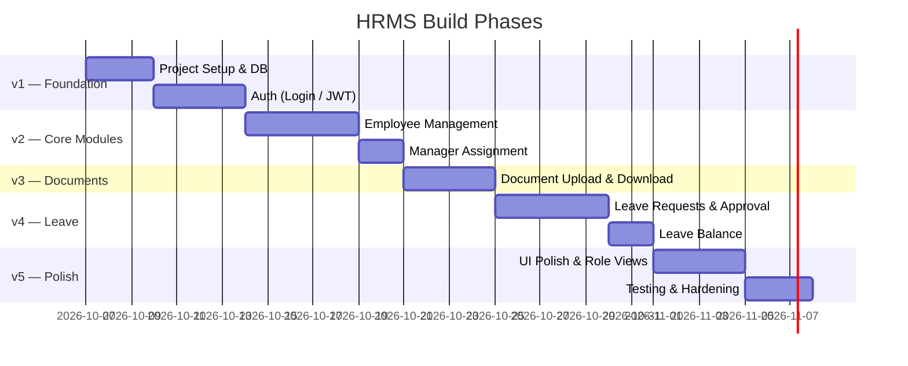
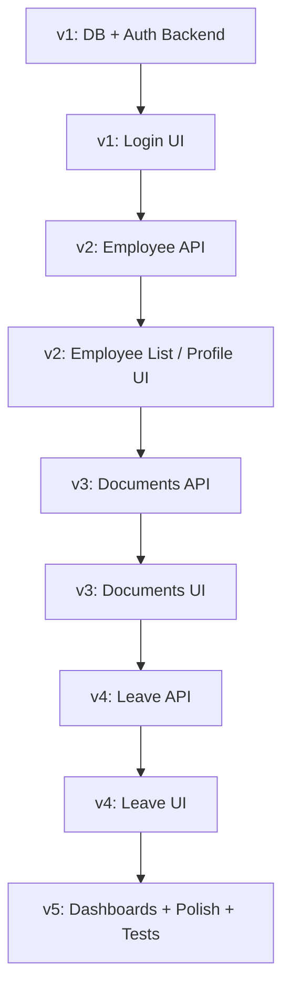

# HRMS — Versioned Implementation Roadmap
**Project:** Human Resource Management System  
**Stack:** React.js · ASP.NET Core · SQL Server · EF Core · JWT  
**Status:** Planning  

---

> [!IMPORTANT]
> Each version is **independently deployable and demonstrable**. Later versions layer on top of earlier ones — never break earlier work.

---

## Overview



---

## Version 1 — Foundation & Authentication

> **Goal:** Working project skeleton with login/logout and role-aware routing. Nothing else, but it should run end-to-end.

### 1.1 Backend Setup
- [ ] Create **ASP.NET Core Web API** project (`HrmsApi`)
  - Folder structure: `Controllers/`, `Services/`, `Repositories/`, `Models/`, `DTOs/`, `Data/`
- [ ] Add NuGet packages: `Microsoft.EntityFrameworkCore.SqlServer`, `Microsoft.AspNetCore.Authentication.JwtBearer`, `BCrypt.Net-Next`, `FluentValidation.AspNetCore`
- [ ] Configure **`appsettings.json`** — connection string, JWT secret/issuer/audience/expiry
- [ ] Create **`AppDbContext`** and add all 5 entity models: `User`, `Employee`, `Document`, `LeaveRequest`, `LeaveBalance`
- [ ] Run initial **EF Core code-first migration** → create SQL Server database + all tables with FK constraints
- [ ] Seed **3 default users** (one Admin, one Manager, one Employee) for testing

### 1.2 Auth API
- [ ] `POST /api/auth/login` — validate email+password (BCrypt), return signed JWT with `{ userId, role, name }`
- [ ] `POST /api/auth/logout` — client-side token removal (return 200)
- [ ] `GET /api/auth/me` — decode JWT, return logged-in user info
- [ ] **Middleware:** Global JWT validation, Role-based `[Authorize]` guards

### 1.3 Frontend Setup
- [ ] Create **React app** (`hrms-client`) with Vite
  - Folder structure: `src/api/`, `src/components/`, `src/context/`, `src/pages/`, `src/hooks/`
- [ ] Install: `axios`, `react-router-dom`, `react-toastify`
- [ ] Configure **Axios** base URL + interceptor to attach `Authorization: Bearer <token>` header on every request
- [ ] Create **`AuthContext`** — stores `{ user, token, role }`, provides `login()` / `logout()` functions
- [ ] Create **`ProtectedRoute`** component — redirects unauthenticated users to `/login`

### 1.4 Login UI
- [ ] **Login page** — centred card, email + password fields, submit button
- [ ] On success: store token in `localStorage`, redirect to `/dashboard` based on role
- [ ] On failure: show toast error

### ✅ v1 Deliverable
> A running application where any of the 3 seeded users can log in, see a role-aware placeholder dashboard, and log out.

---

## Version 2 — Employee Management

> **Goal:** Admin can add, view, edit, and deactivate employees. Managers can see their own team. Employees can view their own profile.

### 2.1 Backend
- [ ] `GET /api/employees` — Admin: return all; Manager: return only direct reports
- [ ] `GET /api/employees/{id}` — Any authenticated user (Employees restricted to own profile)
- [ ] `POST /api/employees` — Admin only; creates `User` + `Employee` + `LeaveBalance` in a transaction
- [ ] `PUT /api/employees/{id}` — Admin only; update department, position, salary, manager
- [ ] `PATCH /api/employees/{id}/status` — Admin only; toggle Active/Inactive

**DTOs:**
- `CreateEmployeeDto` — Name, Email, Password, Department, Position, Salary, JoiningDate, ManagerID?, Role
- `EmployeeResponseDto` — excludes PasswordHash and internal fields
- `UpdateEmployeeDto` — Department, Position, Salary, ManagerID

**Validations (FluentValidation):**
- Email must be unique
- Salary must be > 0
- JoiningDate cannot be in the future
- ManagerID must reference a valid Employee

### 2.2 Frontend
- [ ] **Employee List page** (`/employees`)
  - Data table with columns: Name, Department, Position, Status, Manager, Joining Date
  - Search bar (filter by name/department)
  - Status filter chip (Active / Inactive)
  - Pagination (10 per page)
  - **Add Employee** button (Admin only — hidden for other roles)
- [ ] **Add Employee modal / drawer** (Admin only)
  - Form with all fields + inline validation
  - On submit: POST → refresh list → success toast
- [ ] **Employee Detail / Edit page** (`/employees/:id`)
  - View mode for all roles
  - Edit form visible only to Admin
  - Deactivate button (Admin only)
- [ ] **My Profile page** (`/profile`) — Employee's own record, read-only

### 2.3 Manager Assignment
- [ ] Dropdown in Add/Edit Employee form populated from `GET /api/employees?role=Manager`
- [ ] Manager dashboard shows only their direct reports on Employee List page

### ✅ v2 Deliverable
> Admin can fully manage employees. Manager sees their team. Employees can view their profile.

---

## Version 3 — Document & Policy Management

> **Goal:** Admin can upload company documents; all authenticated users can browse and download them.

### 3.1 Backend
- [ ] Configure **static file storage** — documents saved to `wwwroot/uploads/` (or configurable path outside web root)
- [ ] `GET /api/documents` — All authenticated; returns list of active docs: `DocumentID, Title, Category, UploadedAt, UploadedByName`
- [ ] `GET /api/documents/{id}` — All authenticated; returns metadata (no `FilePath`)
- [ ] `GET /api/documents/{id}/download` — All authenticated; streams file; `FilePath` resolved server-side only
- [ ] `POST /api/documents` — Admin only; `multipart/form-data` upload; validate MIME type (PDF, JPEG, PNG) + max 10 MB
- [ ] `PUT /api/documents/{id}` — Admin only; update Title / Category
- [ ] `PATCH /api/documents/{id}/deactivate` — Admin only; soft-delete (`IsActive = false`)

**Security note:** `FilePath` is NEVER returned in any API response — only used internally to resolve file stream.

### 3.2 Frontend
- [ ] **Documents & Policies page** (`/documents`)
  - Category filter tabs: All | Policy | Handbook | Template | Compliance | Other
  - Document grid/cards — Title, Category, upload date, Download button
  - **Upload Document** button (Admin only)
- [ ] **Upload Document modal** (Admin only)
  - Drag-and-drop file input + Title + Category dropdown
  - File type + size validation on client side
  - Progress indicator during upload
- [ ] **Manage Documents panel** (Admin only)
  - Edit title/category inline
  - Deactivate (soft-delete) with confirmation dialog
- [ ] Download triggers `GET /api/documents/{id}/download` → browser file download

### ✅ v3 Deliverable
> Admin can upload and manage company documents. All users can browse active documents by category and download them.

---

## Version 4 — Leave Management

> **Goal:** Employees apply for leave; managers approve or reject; leave balance updates automatically.

### 4.1 Backend
- [ ] `GET /api/leave` — Role-filtered:
  - Admin: all requests
  - Manager: requests from their direct reports
  - Employee: own requests only
- [ ] `GET /api/leave/balance` — Returns `TotalLeaves, UsedLeaves, RemainingLeaves` for logged-in employee
- [ ] `POST /api/leave` — Employee only; validates date range, checks remaining balance, inserts with `Status = 'Pending'`
- [ ] `PUT /api/leave/{id}/approve` — Manager only; validates employee is a direct report; updates `Status`, sets `ApprovedBy`, `ApprovedAt`; increments `UsedLeaves`, decrements `RemainingLeaves`
- [ ] `PUT /api/leave/{id}/reject` — Manager only; updates `Status`, sets `ApprovedBy`, `ApprovedAt`; does NOT change leave balance

**Business rules:**
- Cannot apply for leave if `RemainingLeaves < days requested`
- Cannot apply for dates in the past
- Start date must be before or equal to end date
- Cannot apply for leave if an overlapping request is already Pending or Approved

### 4.2 Frontend
- [ ] **Leave Requests page** (`/leave`)
  - Tabbed view: **Pending** | **Approved** | **Rejected**
  - Employee view: own requests + Leave Balance summary card (used/remaining/total)
  - Manager view: direct reports' pending requests with Approve / Reject buttons
  - Admin view: all requests, read-only with filter by employee
- [ ] **Apply for Leave modal** (Employee only)
  - Leave Type dropdown (Casual / Sick / Earned)
  - Date range picker (Start + End date)
  - Reason textarea
  - Shows available balance preview
  - Client-side validation before submit
- [ ] **Approve/Reject flow** (Manager)
  - Confirmation dialog before action
  - Row updates in-place after response

### 4.3 Leave Balance Card
- [ ] Circular/ring progress chart showing remaining vs used leaves
- [ ] Separate breakdown per leave type (if needed in future)

### ✅ v4 Deliverable
> Full leave lifecycle is functional. Employees apply, managers act, balance updates, all views filtered by role.

---

## Version 5 — UI Polish, Role Dashboards & Hardening

> **Goal:** Production-ready look and feel, role-specific dashboards with summary widgets, error handling, and security hardening.

### 5.1 Role Dashboards
- [ ] **Admin Dashboard** — Summary widgets: Total Employees, Active/Inactive, Pending Leave Requests, Documents uploaded, Recent joins
- [ ] **Manager Dashboard** — Team size, Pending approvals count, Team leave calendar (current month)
- [ ] **Employee Dashboard** — Leave balance card, recent leave history, quick links (Apply Leave, View Docs)

### 5.2 UI Polish
- [ ] Consistent design system — color tokens, typography scale (Google Font: Inter), spacing units
- [ ] Dark mode toggle
- [ ] Sidebar navigation — collapsible, role-filtered menu items
- [ ] Responsive layout — works on desktop and tablet (min 768px)
- [ ] Skeleton loaders on all data tables and lists
- [ ] Toast notifications (success / error / info) via `react-toastify`
- [ ] Empty state illustrations for empty tables/lists
- [ ] 404 page for unknown routes

### 5.3 Security Hardening
- [ ] JWT expiry set to 24 hours; refresh on activity
- [ ] Token removed from localStorage on logout + `401` interceptor (auto-redirect to login)
- [ ] CORS policy locked to frontend origin only
- [ ] All API responses sanitized — no internal paths or hashed passwords in responses
- [ ] FluentValidation errors returned as structured `{ field, message }` list
- [ ] File upload: MIME type whitelist, max size enforced on both client and server

### 5.4 Testing
- [ ] **Backend unit tests** (xUnit) — Service layer logic: leave balance calculation, employee creation transaction
- [ ] **Backend integration tests** — Auth endpoints, Employee CRUD, Leave approval flow
- [ ] **Frontend smoke tests** (Vitest + Testing Library) — Login flow, Employee list renders, Leave form validation

### ✅ v5 Deliverable
> A polished, hardened, role-aware HRMS application ready for demo or submission.

---

## Folder Structure Reference

```
hrms/
├── HrmsApi/                          ← ASP.NET Core backend
│   ├── Controllers/
│   │   ├── AuthController.cs
│   │   ├── EmployeesController.cs
│   │   ├── DocumentsController.cs
│   │   └── LeaveController.cs
│   ├── Services/
│   │   ├── IAuthService.cs / AuthService.cs
│   │   ├── IEmployeeService.cs / EmployeeService.cs
│   │   ├── IDocumentService.cs / DocumentService.cs
│   │   └── ILeaveService.cs / LeaveService.cs
│   ├── Repositories/
│   │   └── (Generic + specific EF Core repos)
│   ├── Models/                        ← EF Core entity classes
│   │   ├── User.cs
│   │   ├── Employee.cs
│   │   ├── Document.cs
│   │   ├── LeaveRequest.cs
│   │   └── LeaveBalance.cs
│   ├── DTOs/                          ← Request/response objects
│   ├── Data/
│   │   ├── AppDbContext.cs
│   │   └── Migrations/
│   ├── Validators/                    ← FluentValidation classes
│   ├── Middleware/
│   │   └── ExceptionMiddleware.cs
│   └── appsettings.json
│
└── hrms-client/                      ← React + Vite frontend
    ├── src/
    │   ├── api/                       ← Axios instance + API call functions
    │   ├── components/                ← Reusable UI components
    │   ├── context/
    │   │   └── AuthContext.jsx
    │   ├── hooks/                     ← Custom React hooks
    │   ├── pages/
    │   │   ├── Login.jsx
    │   │   ├── Dashboard.jsx
    │   │   ├── Employees.jsx
    │   │   ├── EmployeeDetail.jsx
    │   │   ├── Documents.jsx
    │   │   └── Leave.jsx
    │   ├── App.jsx
    │   └── main.jsx
    └── vite.config.js
```

---

## Build Order Dependency Map



---

## Next Action

Say **"start v1"** and I'll scaffold the full project — create the ASP.NET Core backend, EF Core models, migration, seed data, JWT auth, and the React/Vite frontend with the login page and auth context, all at once.

---

*Roadmap generated for: HRMS Sample / Academic Project — October 2026*
